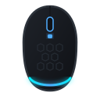

# Nexus Air V1 — Linux Driver & GTK4 Control Center

<p align="center">
  
</p>

<p align="center">
  <strong>Native Linux configuration utility, CLI, and modern GTK4 control center for Claw's Nexus Air V1 wireless and wired gaming mouse.</strong>
</p>

<p align="center">
  <a href="https://github.com/morluto/nexus-air-linux/actions/workflows/ci.yml"></a>
  <a href="https://github.com/morluto/nexus-air-linux/releases"></a>
  <a href="LICENSE"></a>
  
  
</p>

---

## 📖 About This Project

The official software for the **Claw's Nexus Air V1** gaming mouse is only distributed as Windows executables (`Nexus Air V1.exe` + `HIDUsb.dll`). Linux users were left without any way to configure DPI stages, RGB lighting, debounce time, sensor modes, or on-board memory profiles.

This project is a 100% native Linux driver and user-space management suite created from scratch by reverse engineering the proprietary Windows driver and USB HID communication protocols.

### 🔬 Engineering & Credits

* **Reverse Engineering Toolset:** Analyzed and decompiled using the **[REA (Reverse Engineer Anything)](https://github.com/morluto/rea)** toolset and disassembly analyzers.
* **AI Architecture & Implementation:** Grounded, engineered, and synthesized using **Gemini 4 Argon Medium** pair programming directly against live mouse hardware and disassembled PE/COFF obj dumps.
* **Pure User-Space Driver:** Direct low-level communication via Linux `/dev/hidraw*` with zero kernel modules required.

---

## 🖱️ Supported Hardware

| Hardware | Description | USB VID | USB PID | Supported Modes |
|---|---|---|---|---|
| **Nexus Air V1 (Wireless)** | Compx 2.4GHz USB Dongle (v2.00 / Update 1) | `0x3554` | `0xF512` | 2.4GHz Wireless |
| **Nexus Air V1 (Wireless U2)**| Compx 2.4GHz USB Dongle (Update 2) | `0x3554` | `0xF5D5` | 2.4GHz Wireless |
| **Nexus Air V1 (Wired)** | USB-C Direct Cable Connection | `0x3554` | `0xF5A7` | Direct Wired |

* **Sensor:** PixArt PAW3325 (100 – 10,000 DPI)
* **Polling Rates:** 125 Hz, 250 Hz, 500 Hz, 1000 Hz, 2000 Hz, 4000 Hz
* **On-Board Memory:** 4 Hardware EEPROM profile banks

---

## ✨ Features

* **Complete Sensor Tuning:**
  * Configure 1 to 6 DPI stages (100 to 10,000 DPI with exact PAW3325 register scaling).
  * **Individual DPI LED Colors:** Assign custom RGB colors to each DPI stage with interactive color pickers.
  * Polling rate adjustment (125 Hz to 4000 Hz).
  * Lift-Off Distance (LOD: 1mm / 2mm).
  * Click Debounce time (0 to 30 ms).
  * Sensor power modes (Low Power, High Performance, Corded).
  * Motion Sync, Angle Snapping, Ripple Control, and Peak Performance toggles.
  * Configurable inactivity sleep timeouts (30 to 1800 seconds).

* **Dual RGB Lighting Control:**
  * **Bottom RGB Strip:** Rainbow Moving, Single Color Breathing, Fixed Color, Neon, and Rainbow Flicker.
  * **DPI Indicator LED:** Separate control for Fixed, Breathing, or completely OFF mode.
  * Speed (1–8) and Brightness (1–10) controls.
  * Power-saving move-off toggle (turns off LEDs automatically when moving the mouse).
  * One-click "Turn All LEDs Off" button.

* **Hardware Profiles:**
  * Switch between Hardware Profiles 1 to 4 stored directly on the mouse MCU.
  * Automatic backup of configurations to `~/.config/nexus-air/profile_{0..3}.json`.

* **Battery & Diagnostics:**
  * Live battery percentage and millivolt reading with charging detection (`⚡`).
  * Firmware version inspection (`v2.00`).

---

## 🚀 Installation & Usage

### 1. AppImage (Universal for all Linux Distros)
Download the latest `Nexus_Air_V1-x86_64.AppImage` from [GitHub Releases](https://github.com/morluto/nexus-air-linux/releases):

```bash
chmod +x Nexus_Air_V1-x86_64.AppImage

# One-time udev rule installation (so you don't need sudo):
./Nexus_Air_V1-x86_64.AppImage udev

# Launch GTK4 GUI:
./Nexus_Air_V1-x86_64.AppImage
```

### 2. Arch Linux / CachyOS / Manjaro
Install via `PKGBUILD`:
```bash
git clone https://github.com/morluto/nexus-air-linux.git
cd nexus-air-linux/packaging/arch
makepkg -si
```

### 3. Debian / Ubuntu / Linux Mint
```bash
sudo apt install -y python3 python3-gi gir1.2-gtk-4.0
git clone https://github.com/morluto/nexus-air-linux.git
cd nexus-air-linux
pip install .
sudo nexus-air udev
```

### 4. Fedora / RHEL / Nobara
```bash
sudo dnf install -y python3 python3-gobject gtk4
git clone https://github.com/morluto/nexus-air-linux.git
cd nexus-air-linux
pip install .
sudo nexus-air udev
```

---

## 💻 CLI Command Reference

`nexus-air` includes a fully functional CLI that works headlessly with zero GUI dependencies:

```bash
# Show mouse status, battery, active profile, and current settings
nexus-air status

# Set active DPI to 1200 on stage 1 with custom color (Cyan)
nexus-air dpi 1200 --stage 1 --color 0,255,255

# Change polling rate to 1000 Hz
nexus-air rate 1000

# Set RGB Strip to Rainbow Moving with speed 4 and brightness 8
nexus-air led 1 --speed 4 --brightness 8

# Turn off all lights completely (both strip and DPI LED)
nexus-air led 0 --dpi-led 0

# Switch hardware profile to Profile 2
nexus-air profile 2

# Enable Motion Sync and 8ms debounce
nexus-air motionsync on
nexus-air debounce 8

# Reset mouse to factory defaults
nexus-air reset
```

---

## 🛠️ Project Structure

```
my-mouse-claws/
├── data/
│   ├── 99-nexus-air.rules                # udev permission rules
│   ├── icons/nexus-air.svg               # Scalable vector application icon
│   └── org.cachyos.NexusAirV1.desktop    # FreeDesktop desktop launcher
├── docs/
│   ├── hardware_protocol.md              # Reverse-engineered EEPROM & HID protocol spec
│   └── superpowers/plans/                # Implementation architecture plans
├── packaging/
│   ├── appimage/                         # AppImage bundling script and AppRun
│   ├── arch/PKGBUILD                     # Arch Linux / CachyOS package build
│   ├── debian/control                    # Debian/Ubuntu package metadata
│   └── rpm/nexus-air.spec                # Fedora / RPM package specification
├── src/nexus_air/
│   ├── __init__.py                       # Package exports and versioning
│   ├── constants.py                      # VID/PID tables, opcodes, default constants
│   ├── protocol.py                       # Checksum, PAW3325 DPI math, packet builders
│   ├── device.py                         # NexusAirDevice /dev/hidraw interface
│   ├── cli.py                            # Headless command-line interface
│   └── gui.py                            # Modern GTK4 visual control center
├── tests/
│   └── test_protocol.py                  # Unit tests for protocol encoding/decoding
├── .github/workflows/
│   ├── ci.yml                            # Multi-python test runner
│   └── release.yml                       # Automated release and AppImage build
├── pyproject.toml                        # PEP 621 Python packaging specification
├── LICENSE                               # MIT License
└── README.md                             # Project documentation
```

---

## 📄 License

This project is licensed under the [MIT License](LICENSE).
Mouse firmware and hardware trademarks belong to their respective owners (Claw's Technology / Compx / PixArt Imaging).
